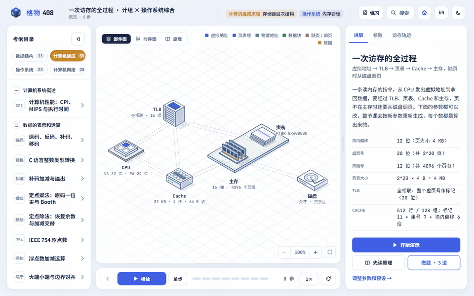
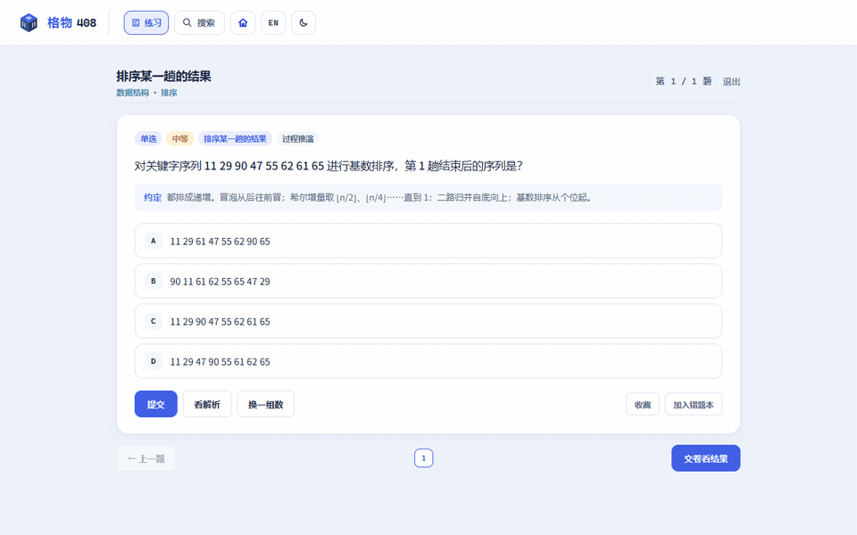

# Gewu 408

**Step-by-step animations for the Chinese CS postgraduate exam (408)**

[简体中文](README.md) ｜ English

Gewu 408 turns the four subjects of the 408 exam — data structures, computer organization, operating systems and computer networks — into interactive animations you can play one step at a time, pause, rewind and inspect down to every bit. Calculation topics take your own parameters (including numbers from past exams) and recompute everything; no result is hard-coded.

- **Try it online:** <https://nyxk7.github.io/gewu-408/> (the site has a Chinese / English switch in the top bar)
- **Offline:** download the single HTML file from [Releases](https://github.com/NyxK7/gewu-408/releases/latest) and double-click it.

| Animated lessons | Questions linked to the animations |
| --- | --- |
|  |  |

## What is inside

- **114 lessons**: data structures 33, computer organization 35, operating systems 23, computer networks 28. Every lesson has a principle page with the core idea, comparison tables and common mistakes.
- **178 practice questions**, including 8 multi-part problems. Each step of every solution links back to the matching animation step; calculation questions can be regenerated with new numbers.
- Chinese and English, light and dark themes, desktop and mobile.

## Running locally

No dependencies. Serve the repository root with any static server, e.g. `node tools/serve.mjs 8408`, then open <http://127.0.0.1:8408/>. `node build-single.mjs` packs everything into one HTML file. Tests: `node --test tests/*.test.mjs` (plus the slower `node --test tests/edge.slow.mjs`).

## Feedback

Found a mistake? Please [open an issue](https://github.com/NyxK7/gewu-408/issues/new/choose). All explanations and questions are original and not copied from past papers or commercial prep books.

## Privacy

The page loads two fonts (Noto Sans SC, JetBrains Mono) from Google Fonts and falls back to system fonts if that fails. It contacts no other service and collects no data; your quiz history stays in your own browser's local storage.

## License

Code: [MIT](LICENSE). Lesson texts, questions and screenshots: [CC BY-NC 4.0](https://creativecommons.org/licenses/by-nc/4.0/).
