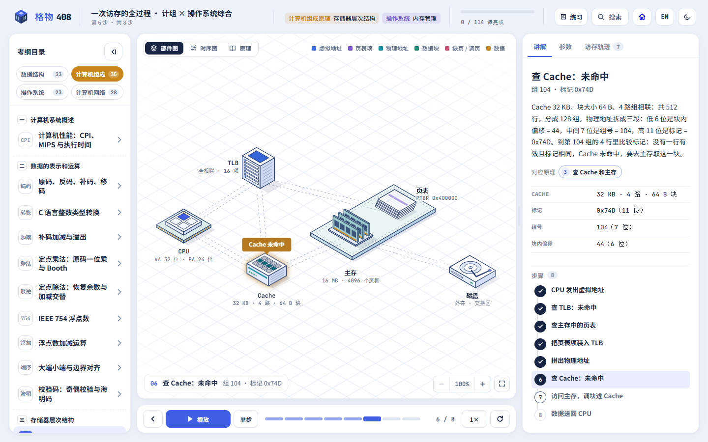
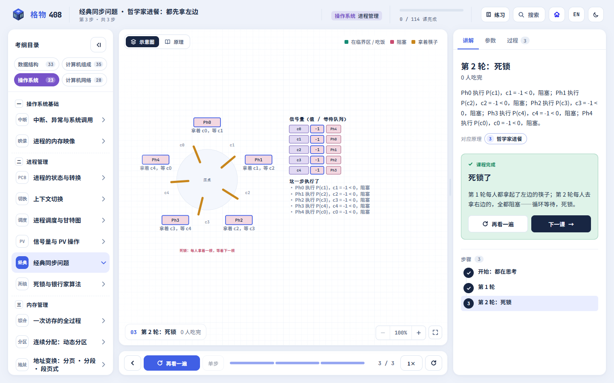
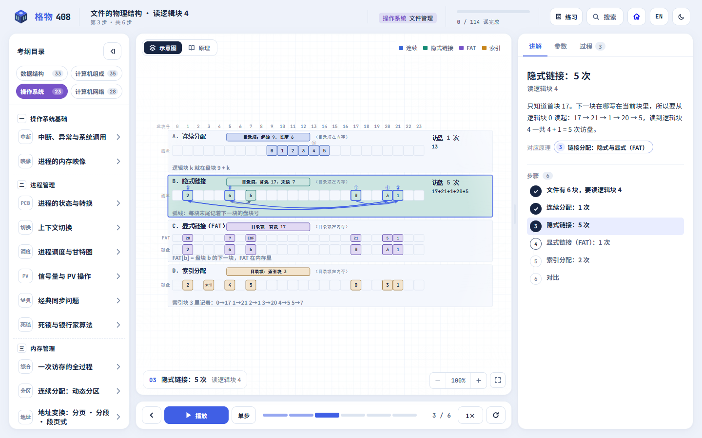

# 格物 408

**把考研 408 的考点一步步演出来。**

名字取自「格物致知」：把一个个考点推究透，自然就懂了。

每节课都是一段可以逐步播放的动画：能暂停、能后退，能点开看每一步的细节；计算类考点可以填入自己的参数（真题里的数也行），动画按输入一步步算出答案。配套的题目每道都连着课程，做错了点「看动画」，就跳到讲这一步的地方。

**在线体验：** <https://nyxk7.github.io/gewu-408/>　·　**离线版：** 下载仓库里的 [`格物408.html`](格物408.html)，双击就能打开，不用联网、不用安装。


## 有什么

| | 数量 | 例子 |
| --- | --- | --- |
| 数据结构 | 33 节课 | 二叉树遍历与还原、B 树、红黑树、Dijkstra、关键路径、KMP、各种排序每一趟的结果、外部排序 |
| 计算机组成原理 | 35 节课 | 补码与浮点数、Cache 映射、一次访存的全过程、指令格式与寻址、数据通路、流水线冒险、中断与 DMA |
| 操作系统 | 23 节课 | 进程调度甘特图、PV 操作与经典同步问题、银行家算法、页面置换、进程的内存映像、文件的物理结构、磁盘调度 |
| 计算机网络 | 28 节课 | 逐层封装、CSMA/CD、子网划分、最长前缀匹配、RIP 与 OSPF、TCP 序号与拥塞控制、DNS、HTTP |
| 练习题 | 178 道 | 选择、填空、计算，另有 8 道综合大题；计算题可以「换一组数」再练，答案由课程里同一份代码算出 |

- 每节课都有「原理」页：要解决什么问题、核心思想、对比表、易错点。
- 按 2026～2027 年考纲逐条核对过，考纲里的知识点都有对应的讲解。
- 中文 / English、浅色 / 深色、电脑 / 手机都能用。

## 看几眼

| 一次访存的全过程 | 哲学家进餐：死锁 |
| --- | --- |
|  |  |
| **文件的物理结构：四种分配方式并排对比** | **进程的内存映像** |
|  |  |

综合题：读懂一个抓到的以太网帧


## 本地运行

不需要安装任何依赖。

- 最简单：双击 `格物408.html`。
- 想改代码：用任意静态服务器打开项目根目录，例如

  ```bash
  node tools/serve.mjs 8408
  ```

  然后访问 <http://127.0.0.1:8408/>。
- 改完重新打包离线版：`node build-single.mjs`（用 esbuild 打成一个 HTML 文件）。
- 测试：`node --test tests/*.test.mjs`；边界值测试比较慢，单独跑：`node --test tests/edge.slow.mjs`（大约 2 分钟）。

纯原生 ES 模块 + SVG，没有用框架。主要目录：

```
js/subjects/{ds,co,os,net}   各科课程：xxx.js 是纯计算，xxx-lesson.js 是画面和讲解
js/quiz/                     题库和做题页
js/core/                     播放引擎、参数面板、双语
tests/                       单元测试、题库测试、边界值测试
docs/                        知识点覆盖报告（考纲里每个考点对应哪节课）、截图
```

## 说明

- 所有题目和讲解都是自己写的，没有照抄真题原文，也没有使用任何辅导书的文字和图片；题目的数字和答案由代码生成。
- 这是配合复习用的工具，不能代替教材和老师。内容难免有错，发现问题欢迎提 [Issue](../../issues)。
- 考纲里每个考点对应哪节课、讲到什么程度，见 [docs/覆盖报告.md](docs/覆盖报告.md)。

## 许可

- 代码：[MIT](LICENSE)
- 讲解文字、题目、截图等内容：[CC BY-NC 4.0](https://creativecommons.org/licenses/by-nc/4.0/deed.zh-hans)，可以转载和改编，但要署名、不能用于商业用途。
