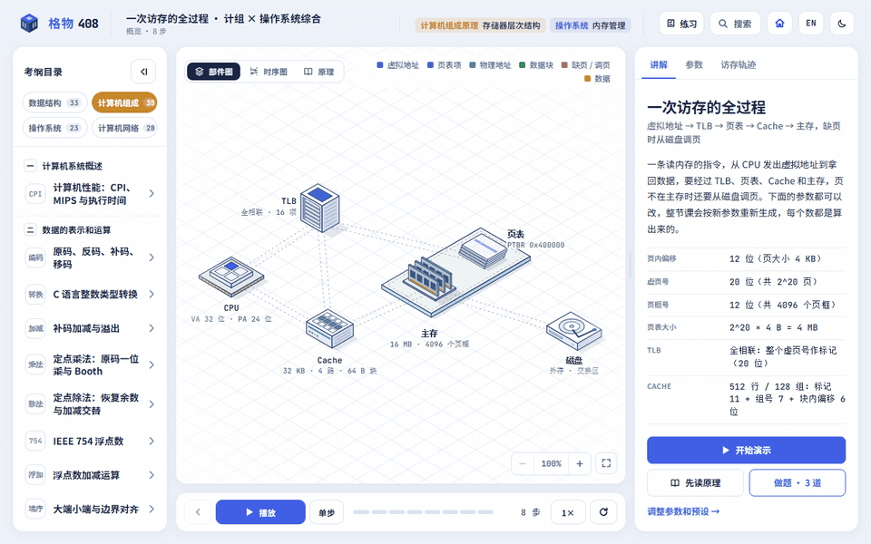
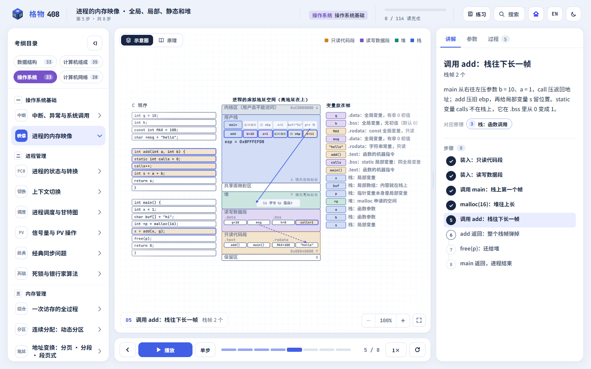
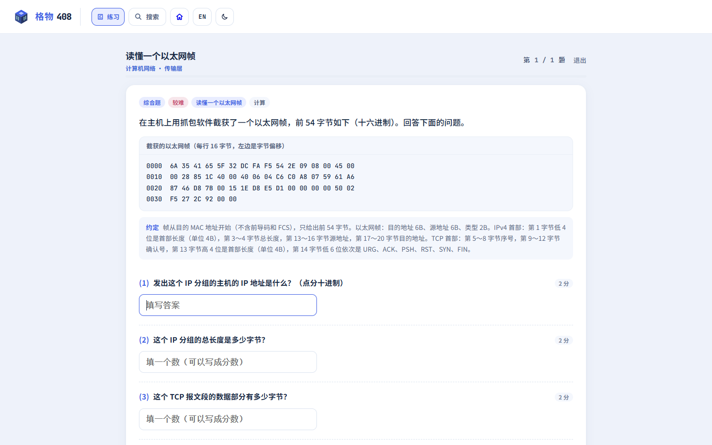

<div align="center">

<a href="https://nyxk7.github.io/gewu-408/"></a>

# 格物 408

**把考研 408 的考点一步步演出来**

可以逐步播放、可以改参数的交互动画 · 配套题库 · 打开网页就能用

<a href="https://nyxk7.github.io/gewu-408/"></a>&nbsp;
<a href="https://github.com/NyxK7/gewu-408/releases/latest"></a>


简体中文 ｜ [English](README.en.md)

</div>

<table>
<tr>
<td width="50%"></td>
<td width="50%"></td>
</tr>
<tr>
<td align="center"><b>动画讲解</b>：一步一步播放，每一步都能停下来看细节</td>
<td align="center"><b>做题 → 看动画</b>：解析的每一步都能跳回课程里那一步</td>
</tr>
</table>

## 为什么做这个

408 的很多考点，教材上是一张静态的图、一段文字，真正难的是「中间那几步到底发生了什么」：页表怎么查、Cache 组号怎么算、PV 操作怎么一步步走进死锁、快排第二趟以后为什么至少有两个元素到位……

格物 408 把这些过程做成可以逐步播放的动画：

- **一步一停**：能暂停、能后退，每一步都有讲解，点开能看到每一位、每一个变量的值。
- **参数可改**：计算类考点都能填入自己的数（真题里的数也行），动画按输入重新算一遍。所有结果都由代码算出，不是写死的。
- **讲练结合**：178 道练习题（含 8 道综合大题），每道题的解析都连着课程；计算题可以「换一组数」反复练。
- **按考纲组织**：按 2026～2027 年考纲逐条核对，四门课的知识点都有对应讲解，每节课还有「原理」页：核心思想、对比表、易错点。
- **随处可用**：中文 / English、浅色 / 深色、电脑 / 手机；离线版是一个 HTML 文件，双击就能打开。

## 从这里开始

| 科目 | 推荐先看 |
| --- | --- |
| 数据结构 | [快速排序](https://nyxk7.github.io/gewu-408/#/l/quicksort) · [B 树](https://nyxk7.github.io/gewu-408/#/l/btree) · [Dijkstra](https://nyxk7.github.io/gewu-408/#/l/dijkstra) · [KMP](https://nyxk7.github.io/gewu-408/#/l/kmp) |
| 计算机组成原理 | [一次访存的全过程](https://nyxk7.github.io/gewu-408/#/l/vm-access) · [IEEE 754](https://nyxk7.github.io/gewu-408/#/l/ieee754) · [流水线冒险](https://nyxk7.github.io/gewu-408/#/l/pipeline) · [Cache 映射](https://nyxk7.github.io/gewu-408/#/l/cache-map) |
| 操作系统 | [页面置换](https://nyxk7.github.io/gewu-408/#/l/page-replace) · [进程调度](https://nyxk7.github.io/gewu-408/#/l/cpu-sched) · [读者写者与哲学家](https://nyxk7.github.io/gewu-408/#/l/sync-classic) · [银行家算法](https://nyxk7.github.io/gewu-408/#/l/banker) |
| 计算机网络 | [TCP 拥塞控制](https://nyxk7.github.io/gewu-408/#/l/tcp-cc) · [子网划分](https://nyxk7.github.io/gewu-408/#/l/subnet) · [CSMA/CD](https://nyxk7.github.io/gewu-408/#/l/csma-cd) · [最长前缀匹配](https://nyxk7.github.io/gewu-408/#/l/lpm) |
| 练习 | [全部题目](https://nyxk7.github.io/gewu-408/#/q) · [综合大题](https://nyxk7.github.io/gewu-408/#/q/big) · [错题本](https://nyxk7.github.io/gewu-408/#/q/wrong) |

完整目录在网站左侧的「考纲目录」里；考纲里每个考点对应哪节课，见 [覆盖报告](docs/覆盖报告.md)。

## 更多截图

| 文件的物理结构：四种分配方式并排对比 | 哲学家进餐：一步步走进死锁 |
| --- | --- |
|  |  |
| **进程的内存映像** | **综合题：读懂一个抓到的以太网帧** |
|  |  |

## 本地运行

不需要安装任何依赖：

- **只想用**：在 [Releases](https://github.com/NyxK7/gewu-408/releases/latest) 下载离线版 HTML，双击打开。
- **想改代码**：克隆仓库后在根目录启动一个静态服务器，比如 `node tools/serve.mjs 8408`，然后访问 <http://127.0.0.1:8408/>。
- **打包离线版**：`node build-single.mjs`，会在根目录生成单文件版。
- **测试**：`node --test tests/*.test.mjs`；边界值测试较慢，单独跑 `node --test tests/edge.slow.mjs`。

纯原生 ES 模块 + SVG，没有用框架：

```
js/subjects/{ds,co,os,net}   各科课程：xxx.js 是纯计算，xxx-lesson.js 是画面和讲解
js/quiz/                     题库和做题页
js/core/                     播放引擎、参数面板、双语
tests/                       单元测试、题库测试、边界值测试
```

## 反馈与贡献

- **发现讲错了、题目答案不对**：请提一个 [内容纠错](https://github.com/NyxK7/gewu-408/issues/new?template=content-error.yml)，写上哪节课或哪道题、哪里不对、你认为正确的是什么。
- **想要新的考点、新的功能**：提一个 [建议](https://github.com/NyxK7/gewu-408/issues/new?template=suggestion.yml)。
- **想自己动手改**：欢迎 Pull Request，先看一眼 [贡献说明](CONTRIBUTING.md)。

如果它帮到了你，欢迎点一个 ⭐ Star，让更多备考的同学看到。

## 说明

- 所有讲解和题目都是自己写的，没有照抄真题原文，也没有使用任何辅导书的文字和图片；题目的数字和答案由代码生成。
- 这是配合复习用的工具，不能代替教材和老师。内容难免有错，欢迎指正。
- 网页会从 Google Fonts 加载 Noto Sans SC 和 JetBrains Mono 两种字体，加载不了时自动换成系统字体，不影响使用；除此之外不连接任何外部服务，不收集任何数据，做题记录只保存在你自己浏览器的本地存储里。

## 许可

- 代码：[MIT](LICENSE)
- 讲解文字、题目、截图等内容：[CC BY-NC 4.0](https://creativecommons.org/licenses/by-nc/4.0/deed.zh-hans)——可以转载和改编，但要署名、不能用于商业用途。
